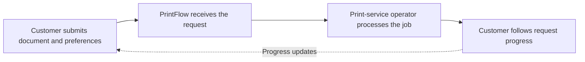

# PrintFlow

**A smoother way to request and manage print jobs.**

PrintFlow is a printing service experience built to make document printing more convenient for customers and easier to manage for print-service operators. Customers can submit print requests and track their progress, while operators can receive and process requests through a connected printing workflow.

> **Product status:** PrintFlow is under development. Features, availability, and service details may change.

## The problem PrintFlow addresses

Getting a document printed can involve multiple steps: preparing a file, communicating print preferences, sending the job to a service provider, and checking whether it has been completed. PrintFlow aims to bring these steps into a clearer, more convenient experience for both customers and the people handling print requests.

## The experience

### For customers

Customers can use PrintFlow to:

- Submit a supported document for printing.
- Choose common print preferences, such as color mode, paper size, number of copies, and double-sided printing.
- Check the progress of a print request.
- Receive clearer feedback if a request cannot be completed as expected.

### For print-service operators

PrintFlow is designed to help operators:

- Receive and review incoming print requests.
- Work with their existing local printing setup.
- Keep track of jobs as they are processed.
- See relevant request and printer information in one place.

The exact experience and available options may depend on the service provider, location, and equipment.

## How a print request works

1. **A customer submits a document** and selects the print preferences they need.
2. **The request is sent to the print service** for handling.
3. **The operator processes the request** using the available printing setup.
4. **The customer can follow progress** until the request reaches a final status.

The diagram below also shows how the customer, PrintFlow, and the print-service operator interact during a request:

In the diagram, the customer starts by submitting a document and choosing print preferences. PrintFlow passes the request to the print-service operator, who handles it using the available printing setup. The customer can also follow the request’s progress until it reaches a final status.

This is a product-level description, not a description of PrintFlow's internal implementation.
This is a product-level description, not a description of PrintFlow's internal implementation.

## Designed with flexibility in mind

PrintFlow is intended to support different printing needs and service environments. The goal is to make the customer experience straightforward while allowing print-service operators to use the equipment and processes that suit their business.

Supported document formats, printer options, job availability, and service hours may vary. Check with the relevant print-service provider for current details.

## Privacy and responsible use

Documents sent for printing may contain personal or confidential information. Only submit documents when you are comfortable sharing them with the relevant print-service provider.

Before using PrintFlow with sensitive documents, review the applicable privacy information and service terms. Details about document handling, retention, and security should be provided through official product documentation when the service is available.

## Product and availability

PrintFlow is under active development. This repository provides a high-level introduction and is not a guarantee of service availability or specific features.

Subscription plans or other paid offerings may be considered for a future release. Pricing, payment options, and availability have not been announced.

## Contact

For product questions, partnership inquiries, or access requests:

- **Contact:** 
- **Updates:** 

## Intellectual property

PrintFlow and its associated materials are the property of their respective owner. This overview is provided for informational purposes. No permission to copy, modify, distribute, or use proprietary materials is granted unless the owner expressly provides that permission in writing.
